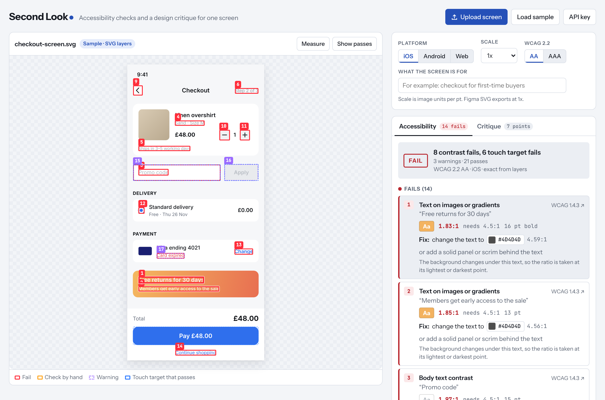
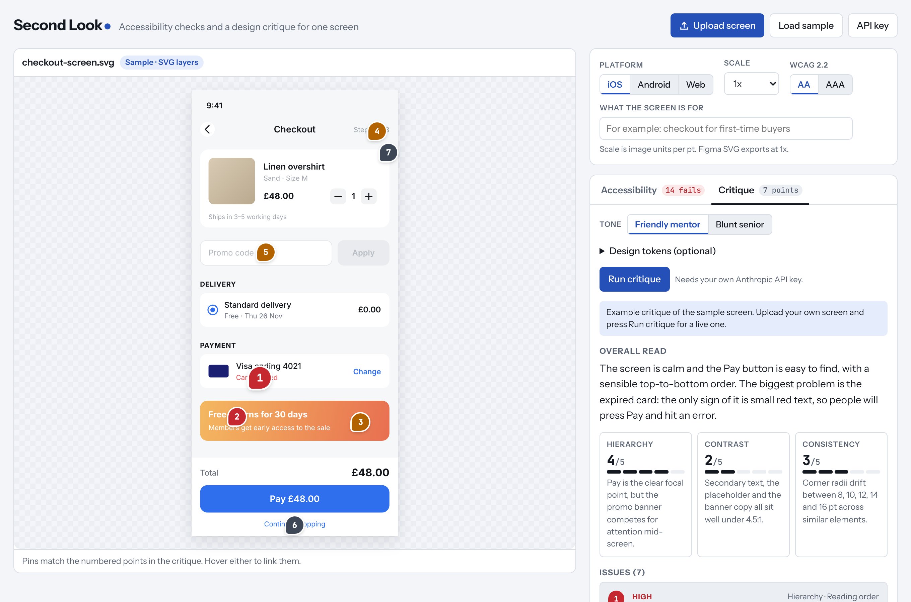

# Second Look

**Accessibility checks and a design critique for one UI screen.** Upload a PNG, JPG or SVG export and get two reads from one upload:

- **Accessibility**: text contrast, non-text contrast and touch target size against WCAG 2.2 AA or AAA, with the nearest passing colour for every fail.
- **Critique**: a senior-designer review of hierarchy, contrast and consistency, with scores, ranked issues and concrete fixes pinned to the screen.





## Why I built it

Design reviews tend to catch the same things late: grey text that's too light, tap targets that are too small, and a screen with three things shouting for attention. Plugins for each of those exist, but they're split across tools and mostly speak in rule numbers. I wanted one place to drop a screen and get a plain-English answer to two questions: *will people be able to read and use this?* and *does it work as a design?*

## How it works

The accessibility checks are **measured in code, not guessed by AI**. AI is used only where it's genuinely better: finding elements in a flat image, and giving a design critique.

| Input | How elements are found | How they're measured | Result |
|---|---|---|---|
| **SVG export** (Figma, Sketch, Penpot) | Layer names and the SVG tree | Exact colours and sizes from the file. The background is sampled from a second render with all text hidden, so anti-aliasing never skews a ratio. | **Exact** |
| **PNG / JPG** | Claude finds text and controls and returns their boxes | Code samples the pixels in each box: the dominant colour is the background, the most contrasting common colour is the text | **Estimated**. Anything within 0.3 of a threshold goes to “check by hand” |

Some details I cared about:

- **Ratios are floored, never rounded.** 4.499:1 shows as 4.49:1 and fails. A checker that rounds up gives false passes.
- **Fixes keep your hue.** The suggested colour is found by moving lightness in OKLab until it passes, so a brand blue stays blue rather than jumping to black.
- **Text on gradients** is judged at its worst 2% of pixels, and the fix suggests a scrim as well as a colour.
- **Platform-aware targets:** 44 pt on iOS (Apple HIG), 48 dp on Android (Material), and 24 px on the web with WCAG 2.5.8's spacing exception worked out properly.
- **Measure tool:** drag a box over anything to check its contrast and size by hand.
- **Reports:** Markdown and PDF reports, plus an annotated PNG of the overlay, ready to drop into a ticket.

What it doesn't do: it can't check screen readers, keyboard order or focus states. Those need built code, and the reports say so.

## Tech

- **Next.js 16** (App Router) and **TypeScript**, deployed on **Vercel**
- **Claude** (Opus 5.5) via the Anthropic SDK, using structured outputs so replies always match a typed schema
- **Vitest** for the colour maths, the WCAG rules and the API routes; GitHub Actions runs type checks, tests and a build on every push
- No UI framework: hand-written CSS with light and dark themes from one set of tokens

```
app/
  api/critique   Claude critique of a screen
  api/locate     Claude finds text and controls in an image
  api/status     whether free hosted runs are available
components/      the UI, with state in useSecondLook
lib/
  colour.ts      WCAG contrast, OKLab and nearest passing colour
  evaluate.ts    judges findings against AA / AAA and platform targets
  analyse-svg.ts exact checks from SVG layers
  pixels.ts      pixel sampling for images and the Measure tool
  ai/            prompts, schemas and response clean-up
  export/        Markdown, PDF and PNG exports
  server/        API key handling and daily limits
tests/
```

## AI usage and API keys

The live site offers a small number of **free critiques each day** on my key, capped per visitor and per day. After that, or any time, you can add **your own Anthropic API key**. It's sent with each request through the app's server to Anthropic and is never stored or logged there. “Remember on this device” keeps it in your browser only.

Prompts live on the server, so the hosted key can only run these two jobs, not arbitrary requests.

## Run it locally

```bash
npm install
cp .env.example .env.local   # add ANTHROPIC_API_KEY, or leave it empty and use your own key in the app
npm run dev
```

Open http://localhost:3000. The sample screen loads with its checks already run, so you can try everything except the live critique without a key.

```bash
npm test           # unit tests
npm run typecheck
npm run build
```

## Deploy

1. Import the repo in [Vercel](https://vercel.com/new).
2. Add `ANTHROPIC_API_KEY` as an environment variable. Optionally set `DAILY_LIMIT` and `PER_VISITOR_DAILY_LIMIT` (defaults 60 and 6).
3. For limits that hold across serverless instances, add an Upstash Redis database from the Vercel Marketplace and set `UPSTASH_REDIS_REST_URL` and `UPSTASH_REDIS_REST_TOKEN`. Without it, counts are kept per instance.

## Design decisions

- **One upload, two modes.** Accessibility and critique look at the same screen, so switching tabs never means uploading again, and the critique is told about measured fails so it doesn't contradict them.
- **Exact beats estimated, and says so.** Every result is labelled exact or estimated, and estimated results near a threshold are never shown as a pass or fail.
- **Plain language over rule numbers.** Each finding says what's wrong and what to change, with the WCAG reference as a link rather than the headline.
- **Two critique tones.** “Friendly mentor” for learning, “Blunt senior” for speed. Each point can be rated useful or not, so you can track how much of the critique holds up.

## Licence

MIT
